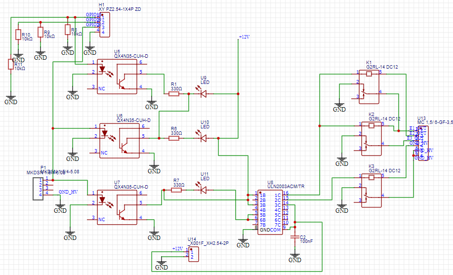
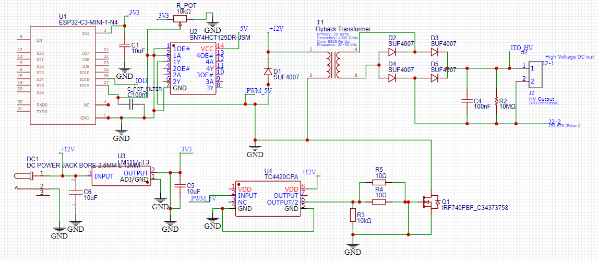
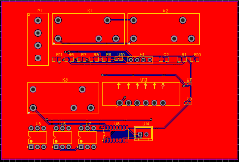
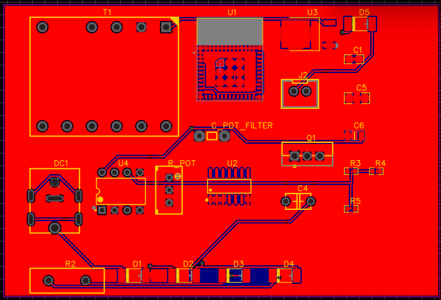
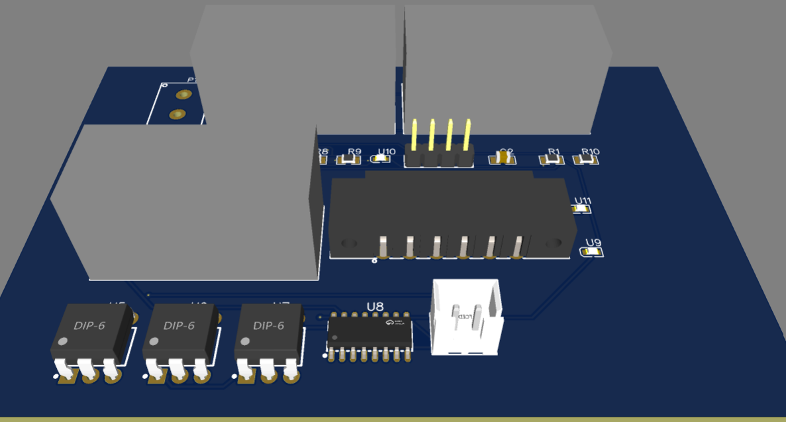
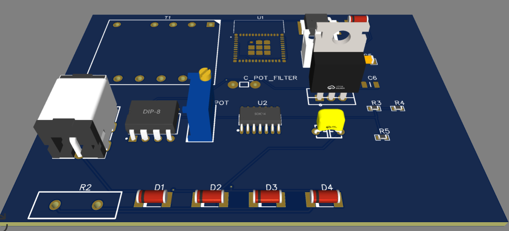
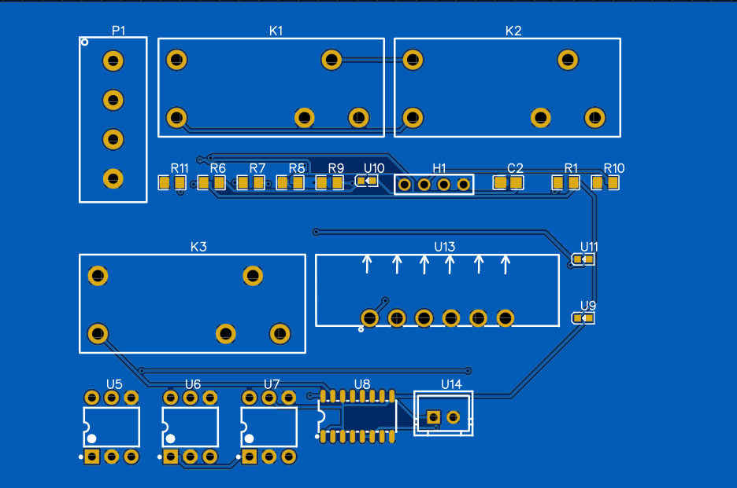
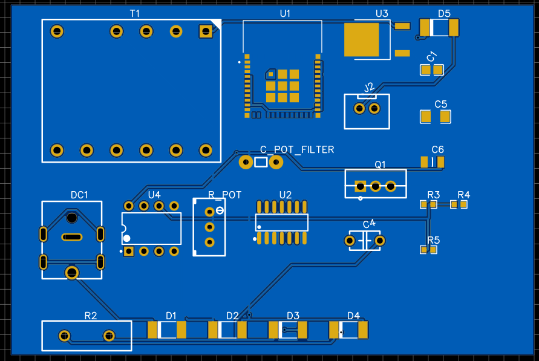

# DustShield Digital Twin

An interactive, browser-based 3D digital twin and operations control dashboard for the **Electrodynamic Dust Shield (EDS)** lunar mission. This application visualizes lunar orbit navigation, surface landing, and real-time EDS physics simulation to clear electrostatic dust from solar panels.

## 🚀 Live Simulation Features

### 1. 3D Lunar Orbit & Navigation
- **Photorealistic Moon & Space Environment**: Renders a textured 3D Moon using high-resolution NASA albedo maps (`assets/nasa/moon.jpg`) suspended in a realistic space skybox with custom procedural starfields.
- **Automated Cinematic Descent**: Initiates an automated descent sequence after a brief orbital telemetry initialization sequence (approx. 6.5s), transitioning the viewport down to the lunar landing site.
- **Dynamic Transition**: Smoothly blends the 3D scene from the global lunar view into the localized lunar surface group and terrain.

### 2. Lunar Surface Operations & 3D Rover View
- **NASA Lunar Rover Integration**: Loads a 3D GLTF rover model (`assets/nasa/rover.glb`) situated directly on the lunar dust bed. A procedurally generated high-fidelity landing pad/rover fallback is rendered if the asset is missing.
- **Focused Camera Zoom**: The camera focuses directly on the rover's solar panels where the dust accumulation and clearing simulation takes place.

### 3. Electrodynamic Dust Shield (EDS) Simulation
- **AC Traveling-Wave Clearing Physics**: Simulates the multi-phase AC high-voltage traveling-wave electrostatic forces used to lift and transport charged lunar regolith particles off the solar panels.
- **Accurate Surface Physics**: Utilizes precision raycasting and tangential plane projection to ensure dust particles correctly slide across any sloped panel surface and realistically detach off edges without relying on artificial bounding boxes.
- **Auto-Shutdown & Efficiency**: EDS efficiently clears dust and gracefully auto-shutdowns at a <=1% residual coverage threshold to accurately lock in and preserve net energy recovery metrics.
- **Interactive Controls Panel**: Real-time configuration inputs:
  - **Voltage (V_pp) Slider**: Adjusts the electrostatic potential strength. Higher voltages clear dust faster and handle heavier particles.
  - **Frequency (Hz) Slider**: Alters the propagation speed of the traveling wave.
  - **Phase Mode Selector**: Toggles between 2-Phase and 3-Phase AC wave configurations to optimize travel characteristics.
- **Dust Coverage Telemetry**: Real-time readouts displaying remaining dust coverage percentage, active solar panel efficiency (inversely proportional to dust coverage), and electrostatic field status.

### 4. Telemetry & Hardware Integration HUD
- **Mission Status Indicators**: Visual warnings and alerts related to Dust Accumulation 
- **Mock MCU / UART Terminal**: Toggleable hardware serial console mimicking an ESP32/MCU UART interface. Shows mock telemetry payloads, status frames, and allows manual control sequence injections.

### 5. Responsive Mobile & Tablet Layout
- **Vertical Workspace Stacking**: On smaller viewports (< 768px), the layout shifts to stack the 3D viewport at the top (`45vh`) with scrollable parameter controls below, ensuring users can interact with sliders while observing the real-time simulation.
- **2-Tier Mobile Header**: Smartphone displays (< 600px) use a CSS Grid reflow that splits the header into an identity row and a secondary telemetry ribbon, keeping all data points visible and un-clipped.
- **Compressed HUD Overlay Elements**: The 3D overlay panel compresses telemetry pills (hiding progress bar tracks) and shrinks the orbit buttons to maximize canvas visibility.

---

##  Scientific Energy Recovery Model

The digital twin implements an empirical solar attenuation model based on the Beer-Lambert law to simulate how dust coverage degrades solar cell efficiency and to compute the net energy recovered during electrodynamic clearing.

### 1. Attenuation & Transmission Model
The transmission factor of light through the dust layer $T(C)$ is modeled as an exponential decay function of the dust coverage percentage $C$ ($0 \le C \le 100$):

$$T(C) = e^{-K \cdot C}$$

Where:
- $T(C)$ is the fraction of light transmitted to the solar cells ($0 \le T \le 1$).
- $K = 0.03$ is the dust attenuation coefficient, calibrated to match lunar regolith spectral absorption and scattering data.

### 2. Instantaneous Solar Power Output
The instantaneous power output of the solar panel array $P(C)$ at any coverage level $C$ is calculated as:

$$P(C) = P_{\text{max}} \cdot T(C) = P_{\text{max}} \cdot e^{-K \cdot C}$$

Where:
- $P_{\text{max}} = 240 \text{ W}$ is the peak power output when the solar panels are completely clean ($C = 0\%$).

### 3. Baseline (Fully Dusty) Power
When the solar panel is completely covered in dust ($C = 100\%$), it still generates a minimal amount of power from diffuse or ambient scattered light:

$$P_{\text{base}} = P_{\text{max}} \cdot e^{-K \cdot 100} = 240 \cdot e^{-0.03 \cdot 100} = 240 \cdot e^{-3} \approx 11.95 \text{ W}$$

### 4. Instantaneous Power Recovered
The power recovered ($P_{\text{recovered}}$) relative to the worst-case fully dusty baseline is:

$$P_{\text{recovered}}(C) = \max\left(0, P(C) - P_{\text{base}}\right)$$

### 5. Net Energy Recovered Accumulation
The total net energy recovered ($E_{\text{recovered}}$, in Watt-hours) is the time-integral of the recovered power, accumulated only while the electrostatic dust shield (EDS) is actively clearing dust (i.e. when the EDS is active and $C > 0$):

$$E_{\text{recovered}} = \int_{t_{\text{start}}}^{t_{\text{end}}} P_{\text{recovered}}(t) \, dt \approx \sum_{t} \frac{P_{\text{recovered}}(t) \cdot \Delta t}{3600}$$

Where:
- $\Delta t$ is the simulation time step between animation frames (in seconds).
- The factor of $3600$ converts seconds to hours to yield energy in Watt-hours ($\text{Wh}$).

---

## 📁 Project Structure

```bash
DustShield/
├── assets/
│   └── nasa/
│       ├── moon.jpg          # Moon surface texture map
│       ├── moon_albedo.jpg   # High resolution lunar albedo map
│       ├── rover.glb         # 3D GLTF model of the lunar rover
│       └── moon_small.glb    # Lightweight moon 3D geometry
├── newfirmware/
│   └── newfirmware.ino       # ESP32-C3 hardware control firmware (C++/Arduino)
├── gerber_eds_sequencerboard/
│   ├── How-to-order-PCB.txt  # Instructions for PCB manufacturing
│   └── *.DRL, *.G*, etc.     # Gerber files for EDS Sequencer Board
├── gerber_hv_board/
│   ├── How-to-order-PCB.txt  # Instructions for PCB manufacturing
│   └── *.DRL, *.G*, etc.     # Gerber files for High-Voltage Board
├── hardware/
│   ├── BOM_dustshield_eds_sequencer_board.csv    # Sequencer Board Bill of Materials
│   ├── BOM_dustshield_hv_board.csv           # High-Voltage Board Bill of Materials
│   ├── PCB_dustshield_final_2026-06-11.pcbdoc    # EasyEDA PCB design project source file
│   ├── schematic_eds_sequencer.png           # Sequencer Board Circuit Schematic
│   ├── schematic_hv_board.png                # High-Voltage Board Circuit Schematic
│   ├── pcb_top&bottom_eds_sequencer.png      # Sequencer Board Track Routing Layout
│   ├── pcb_top&bottom_hv_board.png           # High-Voltage Board Track Routing Layout
│   ├── 3d_view_eds_sequencer.png             # Sequencer Board 3D PCB Render
│   ├── 3d_view_hv_board.png                  # High-Voltage Board 3D PCB Render
│   ├── 2d_view_eds_sequencer_board.png       # Sequencer Board 2D Outline
│   └── 2d_view_hv.png                        # High-Voltage Board 2D Outline
├── index.html                # Main HUD dashboard and 3D container layout
├── index.css                 # Glassmorphic premium dashboard styling & animations
├── main.js                   # Three.js rendering engine, descent/ascent logic, & EDS physics loop
├── CSS_TOKENS.css            # Standardized UI colors, spacing, and styling tokens
├── DESIGN_SYSTEM.md          # Architectural specifications of the user experience
└── README.md                 # Project documentation (this file)
```

---

## 🛠️ How to Run Locally

### 1. Retrieve Large 3D Assets (Git LFS)
This repository uses **Git LFS (Large File Storage)** to manage the binary 3D assets (e.g., `.glb` models for the Moon globe and rover). If you cloned the repository without Git LFS active, you will only have small text pointer files, which will cause Three.js loading errors.

Before running the application, make sure Git LFS is installed and pull the binary files:
```bash
# Ensure Git LFS is installed on your system (e.g., 'brew install git-lfs' on macOS)
git lfs install

# Pull the binary assets
git lfs pull
```

### 2. Run the Local HTTP Server
Since the application uses Three.js and loads external assets via Web APIs, running it directly by double-clicking the `index.html` file will trigger CORS security blocks in your browser. 

Please run it through a local web server:

1. **Open your terminal** and navigate to the project directory:
   ```bash
   cd /path/to/DustShield
   ```

2. **Start a local HTTP server** using Python:
   ```bash
   python3 -m http.server 8000
   ```

3. **Open your browser** and navigate to:
   [http://localhost:8000](http://localhost:8000)

### 3. Hardware Assembly (Optional)
- **Order PCBs**: Fabricate the PCBs using the production-ready Gerber files located in `gerber_eds_sequencerboard/` (for the Sequencer Board) and `gerber_hv_board/` (for the High-Voltage Board).
- **Source Components**: Source electronic components using the LCSC supplier part links provided inside the BOM files: `hardware/BOM_dustshield_eds_sequencer_board.csv` and `hardware/BOM_dustshield_hv_board.csv`.
- **Assemble Boards**: Assemble and solder the components following the circuit schematics located in the `hardware/` folder.
- **Flash Firmware**: Connect the ESP32-C3 to your computer and flash the firmware (`newfirmware/newfirmware.ino`) using the Arduino IDE.


---

## 🔌 Hardware Architecture

### How the Three Boards Work Together

1. **HV Driver Board** – Converts 12 V DC into a high‑voltage DC output (1‑5 kV). An onboard ESP32‑C3 generates a 30 kHz PWM signal whose duty cycle (0‑45%) is controlled by a potentiometer. This PWM drives a gate driver and MOSFET that switches a flyback transformer, producing the high voltage.
2. **Sequencer Board** – Takes the high‑voltage DC from the HV board and switches it to three output channels (E1, E2, E3) in a repeating 6‑step pattern. The switching is controlled by three logic signals from the ESP32 (GPIO19, 20, 21). Optoisolators provide 4 kV isolation between the low‑voltage ESP32 side and the high‑voltage relay outputs.
3. **Electrode Surface (Hand‑Made)** – Three physically separated conductive strips (E1, E2, E3) placed on an insulating base. The sequencer applies high voltage to these strips one after another, creating a traveling electric field. Dust particles become charged, lift off, and are pushed laterally by the moving field.

The system works as a chain: **12 V → HV Board → HV DC → Sequencer → 3‑phase HV pulses → Electrode strips → Traveling wave → Dust removal.**

---

### Board 1: High-Voltage Flyback Driver (HV Board)

**Purpose:** Converts 12V DC to 1-5 kV DC for powering the EDS.

**Key files:**
- Schematic: [schematic_hv_board.png](hardware/schematic_hv_board.png)
- BOM: [BOM_dustshield_hv_board.csv](hardware/BOM_dustshield_hv_board.csv)
- EasyEDA PCB: [PCB_dustshield_final_2026-06-11.pcbdoc](hardware/PCB_dustshield_final_2026-06-11.pcbdoc)

### Board 2: 3-Phase Sequencer Board

**Purpose:** Switches the HV DC to three electrode outputs in sequence, creating the traveling wave.

**Key files:**
- Schematic: [schematic_eds_sequencer.png](hardware/schematic_eds_sequencer.png)
- BOM: [BOM_dustshield_eds_sequencer_board.csv](hardware/BOM_dustshield_eds_sequencer_board.csv)
- EasyEDA PCB: [PCB_dustshield_final_2026-06-11.pcbdoc](hardware/PCB_dustshield_final_2026-06-11.pcbdoc)

---

### Board 3: Electrode Surface – Simple Hand‑Made Version (No PCB Required)

**Purpose:** Creates the traveling electric field that moves dust. This DIY approach is ideal for prototyping and MVP demonstrations.

#### Materials (common and cheap):
- Non‑conductive base: cardboard, glass, or plastic sheet (≥ 100×80 mm)
- Conductive strips: **copper tape** (1–2 mm wide) **or** insulated solid core wire (AWG30, stripped)
- Ruler, knife/scissors, tape

#### Step‑by‑step construction:
1. **Prepare the base** – clean the surface.
2. **Mark three parallel lines** – spacing **1 mm** between lines. Use a ruler.
3. **Apply the electrodes:**
   - *Copper tape:* Cut three strips of copper tape, 1 mm wide and 80 mm long. Stick them along the marked lines.
   - *Wire:* Strip insulation from three lengths of wire. Tape them down straight.
4. **Create the three phases:** Label the strips **E1, E2, E3** from top to bottom (or left to right).
5. **Connect to the sequencer:**
   - Sequencer `J4` Pin 1 (`E1_OUT`) → E1 strip
   - Sequencer `J4` Pin 2 (`E2_OUT`) → E2 strip
   - Sequencer `J4` Pin 3 (`E3_OUT`) → E3 strip
   - Sequencer `J4` Pin 4‑6 (`GND_HV`) → leave unconnected (floating).
6. **Optional – improve field uniformity:** Repeat the three‑strip pattern several times (e.g., E1, E2, E3, E1, E2, E3). Connect all E1 strips together, all E2 together, all E3 together. This mimics the interdigitated fingers.

**How the third phase works:** The sequencer cycles through 6 steps (E1→E2→E3→E1…). With three physically separate strips, the electric field moves from one strip to the next, creating a traveling wave that pushes dust across the surface.

**Testing:** Sprinkle talcum powder or fine sand on the electrode. Power on the system (12 V, potentiometer at 50%). You will see dust hopping and moving laterally.

> [!NOTE]
> **No firmware changes needed** – the same 6‑step pattern works with any three‑electrode arrangement.

---

## 🛠️ Hardware Schematics & PCB Design

The Electrodynamic Dust Shield (EDS) physical subsystem utilizes a high-voltage driver board and an electrode array designed to generate multi-phase AC traveling electrostatic waves.

### Hardware Layout Specifications

| Parameter | Value |
| :--- | :--- |
| **Electrode trace width** | 1 mm (or use copper tape) |
| **Gap between phases** | 1 mm |
| **HV clearance on PCBs** | 3–4 mm |
| **Output bleeder** | 10 MΩ |

### Schematic & Design Views

| View Type | EDS Sequencer Board | High-Voltage Board |
| :--- | :--- | :--- |
| **Circuit Schematic** |  |  |
| **PCB Top & Bottom Layout** |  |  |
| **3D PCB Render** |  |  |
| **2D PCB Layout** |  |  |

### Bill of Materials (BOM)

The hardware bills of materials are provided directly as clickable spreadsheet files:
- 📊 [Download EDS Sequencer Board Bill of Materials (CSV)](hardware/BOM_dustshield_eds_sequencer_board.csv)
- 📊 [Download High-Voltage Board Bill of Materials (CSV)](hardware/BOM_dustshield_hv_board.csv)

---

## ⚙️ Technologies Used
- **Three.js** (loaded via CDN) for the web-based WebGL 3D rendering pipeline.
- **HTML5 & Vanilla Javascript (ES6+)** for application logic, physics simulation, and state management.
- **Vanilla CSS3** featuring CSS variables, modern flexbox/grid layout systems, glassmorphism filters, and CSS keyframe animations.
- **EasyEDA** for electronic hardware schematic design, PCB layout routing, and production-ready manufacturing outputs (Gerber files).
- **C++ & Arduino** for the micro-controller firmware targeting the ESP32-C3 platform.

