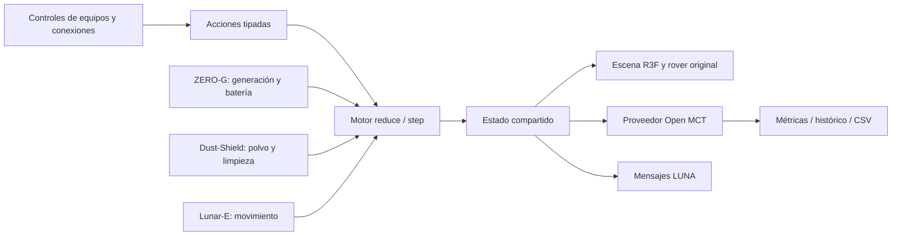

# Arquitectura de la integración

## Workspace y dependencias reales

La raíz contiene cinco workspaces npm: la aplicación React y un paquete `integration/` dentro de cada repositorio original. La aplicación declara cuatro dependencias `file:` que importan archivos de los árboles originales. La raíz coordina instalación, desarrollo, compilación y pruebas.

```text
package.json                         Coordinación npm del workspace
SimuladorParaAstronautasJunior/
  src/gameObjects/                   Objetos del videojuego modularizados (base, rover, orbital, environment, camera, unity)
  src/simulation/                    Estado, conexiones, reglas y pruebas
  src/scene/                         Lienzo Three.js / R3F y fachadas de compatibilidad
  src/components/                    Controles, red y telemetría
final-project-Lunar-E/integration/   Movimiento, cámara y modelo del rover
ZERO-G-Junior-Astronaut-Trainer/
  integration/                       Adaptadores de energía y terreno
  src/game/powerModel.js             Ecuaciones usadas por ambos motores
Dust-Shield/
  integration/                       API de mantenimiento
  src/shared/dustModel.js            Ecuaciones usadas también por main.js
openmct/
  integration/                       Proveedor y plugin de diez canales
  src/api/telemetry/
    TelemetryMetadataManager.js       Implementación original compartida
```

Vite deduplica React, React DOM y Three.js para que el rover y la escena compartan el mismo motor gráfico. Los paquetes ligeros permiten compartir funciones sin montar la UI antigua de cada proyecto. Las carpetas originales deben permanecer junto a la aplicación.

## Flujo común de estado y datos



`useReducer` conserva una sola simulación. Los paquetes aportan funciones y modelos; `engine.ts` relaciona sus resultados con batería, consumo, movimiento, observaciones y transmisión. La escena y los paneles presentan ese mismo estado.

## Conexiones entre dispositivos

| Identificador | Enlace | Consecuencia al interrumpirlo |
| --- | --- | --- |
| `solarBus` | Paneles → red de la estación | La producción no llega a la base; los consumidores utilizan la batería |
| `roverDock` | Base ↔ plataforma del rover | El rover no puede recargarse ni intercambiar datos por el cable de la plataforma |
| `antennaBus` | Base → antena | La antena carece de alimentación y señal para transmitir |
| `roverRadio` | Rover → estación | Sin radio ni cable de plataforma, las lecturas y observaciones nuevas no llegan a la estación |

La limpieza utiliza electricidad y reduce la atenuación calculada por Dust-Shield. La recarga transfiere energía desde la estación al rover. El desplazamiento cercano a los paneles puede aumentar su polvo. Por tanto, conducir y mantener los equipos cambia la generación y el consumo del resto de la red.

El rover acumula `pendingRoverSamples`. Con su radio conectada puede entregar esas observaciones a la estación (`observations`). Transmitir requiere alimentación y señal suficiente; `lastTransmission` conserva tiempo, producción, demanda, baterías, posición, polvo, señal y observaciones. Es una instantánea local, no un envío externo.

La estación conserva `lastRoverTelemetry`: última batería, posición y distancia recibidas. Si pierde el enlace, la conducción y los instrumentos locales del rover siguen funcionando, pero Open MCT y los informes conservan las últimas lecturas conocidas. Al reconectar una radio alimentada o volver a una plataforma conectada se actualizan las lecturas y se entregan las observaciones pendientes.

## Funciones compartidas con los originales

- **Lunar-E:** demo y adaptador comparten cálculo de comandos y movimiento. `@selene/lunar-e/model` expone `createRover` y `updateRover` del modelo original; las utilidades de cámara comparten límites.
- **ZERO-G:** `resourceSystem.js` usa `powerModel.js`, igual que el paquete junior. `calculateStationPower` adapta la generación a W y recibe la eficiencia de Dust-Shield. `integrateBatteryPct` utiliza la ecuación de almacenamiento en Wh. `makeTerrain` exporta directamente el generador original; la escena integrada mantiene plana la zona de práctica.
- **Dust-Shield:** `main.js` importa el módulo extraído de atenuación, potencia recuperada, velocidad y energía. `advanceDust` adapta la velocidad de limpieza a cobertura y recibe la disponibilidad eléctrica de la base.
- **Open MCT:** `TelemetryMetadataManager` organiza unidades, rangos y dominios. El proveedor junior publica muestras reales del motor y ofrece histórico, `request`, `subscribe` y un plugin compatible con las API públicas. La UI completa de la plataforma no se monta en esta versión.

## Tiempo, unidades y telemetría

La potencia se expresa en W. Las capacidades didácticas son **100 Wh** en la estación y **30 Wh** en el rover. La escala energética es **×60**: un segundo de actividad representa un minuto de producción/consumo. Movimiento y reloj usan segundos de actividad. Son parámetros educativos, no predicciones de ingeniería lunar.

El histórico toma una muestra por segundo de actividad y retiene hasta **90 muestras**; el registro conserva **12 operaciones** recientes. El proveedor Open MCT expone diez canales: producción, consumo, batería de estación, batería del rover, señal, polvo, distancia, observaciones, informes y balance. El CSV se genera con los datos disponibles.

## Interfaz, GameObjects y Enlace con Unity

React Three Fiber representa la escena; los objetos del mundo 3D se encuentran modularizados en `src/gameObjects/`:
- `base/`: Complejo lunar (`BaseComplex`), Estación de Control de Vuelo DSN (`FlightControlStation`), Módulo de Residencia (`Habitat`), Paneles Solares (`SolarPanels`), Antena DSN (`CommunicationsDish`), Muelle de Recarga (`ChargingDock`) y Red de Potencia (`PowerCables`).
- `rover/`: Modelo cinemático de Lunar-E y componente interactivo `RoverVehicle`.
- `orbital/`: Estación Espacial Internacional (`InternationalSpaceStation`) y cálculo orbital (`OrbitTrajectory`).
- `environment/`: Terreno (`LunarTerrain`), Bóveda celeste y Tierra (`CelestialSky`), Muestras geológicas (`LunarSamples`) y Elevación (`terrainHeight`).
- `camera/`: Control multicámara orbital y presets (`CameraRig`, `cameraModes`).
- `unity/`: Enlace de mensajería bidireccional (`UnityBridge.ts`) y contratos JSON tipados (`unityContracts.ts`) para integración con Unity WebGL mediante `SendMessage` y eventos en ventana.

Para ampliar un dispositivo, modifica su paquete de origen y el contrato tipado del motor; verifica tanto la demo original como la aplicación integrada. Registra procedencia, licencia y cambios antes de incorporar recursos. Los resultados concretos de verificación corresponden a [VERIFICACION.md](VERIFICACION.md).
